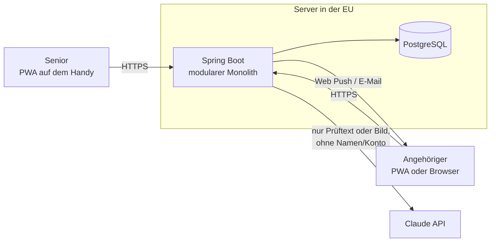
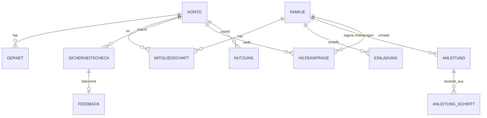
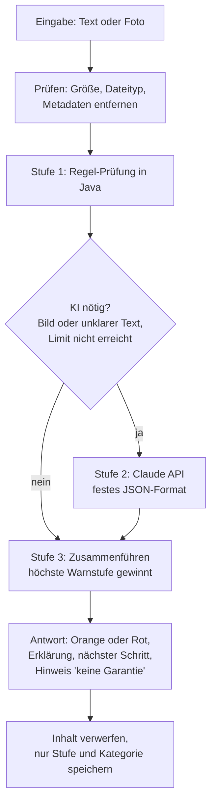
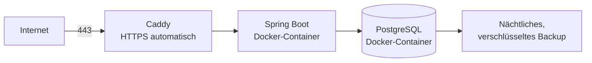
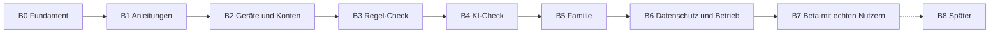

# Bauplan: DigitalBegleiter

Kostenlose Hilfe bei digitalen Problemen für Menschen ab 65 und ihre Familien.
Dieser Bauplan beschreibt, **was** gebaut wird, **wie** es aufgebaut ist und **in
welcher Reihenfolge** es entsteht.

> Stand: 12.11.2026. Der Bauplan gilt erst, wenn die Geschäftsphasen 0 (Gespräche)
> und 1 (Test von Hand mit WhatsApp) positiv waren. Die Liste der häufigsten
> Probleme aus Phase 0 bestimmt den Inhalt der Anleitungen.

---

## 1. Grundsätze

| Grundsatz | Was das im Code bedeutet |
|---|---|
| **Einfach** | Pro Bildschirm eine Aufgabe, große Schaltflächen, kein Fachwort |
| **Sicher** | So wenig Daten wie möglich, Inhalte von Nachrichten werden nicht gespeichert |
| **Ehrlich** | Kein „Grün = sicher“. Nur Orange („keine typischen Warnzeichen“) oder Rot |
| **Kostenlos** | Die Grundhilfe bleibt immer gratis. KI-Kosten werden hart begrenzt |
| **Erweiterbar** | Klare Module, REST-API, KI-Anbieter austauschbar, Tarif-Feld von Anfang an |

---

## 2. Funktionsumfang der ersten Version (MVP)

### Für Senioren
1. **„Ist das echt?“**: Text einfügen oder Foto einer Nachricht aufnehmen und
   eine Einschätzung (Orange/Rot) mit einfacher Erklärung und nächstem Schritt
   bekommen.
2. **„Wie mache ich das?“**: Anleitung suchen („Foto schicken“) und
   Schritt für Schritt durchgehen, passend zum eigenen Handy (Android/iPhone).
3. **„Familie fragen“**: Eine Hilfeanfrage an die Familie schicken. Der Senior
   entscheidet selbst, ob er den Inhalt mitschickt.

### Für Angehörige
4. **Familie anlegen** und Eltern per QR-Code mit dem Handy verbinden.
5. **Hilfeanfragen sehen** und als erledigt markieren.
6. **Eigene Anleitungen schreiben**, zum Beispiel „So rufst du mich per WhatsApp an“.

### Ausdrücklich NICHT in der ersten Version
Bezahlen, Handy-App aus dem App-Store, Spracheingabe, freie KI-Schritt-für-Schritt-
Anleitungen für beliebige Apps, Gesundheitsfunktionen, Fernsteuerung.

---

## 3. Architektur im Überblick



**Modularer Monolith** heißt: Es gibt eine einzige Anwendung (einfach zu
betreiben), aber der Code ist in klar getrennte Module aufgeteilt. Jedes Modul
kann später ausgebaut oder sogar herausgelöst werden.

### Module

| Modul | Aufgabe | Paket |
|---|---|---|
| `konto` | Angehörigen-Konten, Senioren-Geräte, Login, Tarif | `de.digitalbegleiter.konto` |
| `familie` | Familien, Mitgliedschaften, Einladungen, Hilfeanfragen | `de.digitalbegleiter.familie` |
| `anleitung` | Anleitungen, Schritte, Suche | `de.digitalbegleiter.anleitung` |
| `check` | Sicherheitscheck: Regeln, KI-Aufruf, Ergebnis | `de.digitalbegleiter.check` |
| `ki` | Schnittstelle zum KI-Anbieter, Kostenbremse | `de.digitalbegleiter.ki` |
| `benachrichtigung` | Web Push und E-Mail | `de.digitalbegleiter.benachrichtigung` |
| `gemeinsam` | Fehlerbehandlung, Sicherheitskonfiguration, Hilfsklassen | `de.digitalbegleiter.gemeinsam` |
| *später:* `bezahlung` | Abos, Stripe | `de.digitalbegleiter.bezahlung` |

Regel: Module greifen nur über öffentliche Service-Klassen aufeinander zu, nie
direkt auf fremde Repositories oder Tabellen.

---

## 4. Technik-Stack

| Bereich | Wahl | Warum |
|---|---|---|
| Sprache | Java 21 | Kennst du, gleiche Version wie home-library-api |
| Framework | Spring Boot 3, Maven Wrapper | Lernst du parallel in home-library-api |
| Datenbank | PostgreSQL + Flyway | Kennst du; Flyway versioniert die Tabellen |
| Datenzugriff | Spring Data JPA | Wie in home-library-api |
| Sicherheit | Spring Security, Sitzungs-Cookies | Für eine Web-App sicherer als Token im Browser-Speicher |
| KI | Claude API über das offizielle Java-SDK (`com.anthropic`) | Kann Text und Bilder lesen, liefert festes JSON-Format (Structured Outputs) |
| Frontend | PWA mit HTML, CSS, JavaScript | Installierbar wie eine App, kein App-Store; später React möglich |
| Benachrichtigung | Web Push, E-Mail als Ersatz | Kostenlos, funktioniert mit installierter PWA |
| Tests | JUnit 5, Mockito, MockMvc, Testcontainers | Wie in home-library-api |
| Betrieb | Docker Compose auf einem Server in Deutschland, Caddy für HTTPS | Einfach, günstig, Daten bleiben in der EU |
| CI | GitHub Actions | Tests bei jedem Push |

---

## 5. Datenmodell



| Tabelle | Wichtige Spalten | Hinweis |
|---|---|---|
| `konto` | `id`, `typ` (SENIOR/ANGEHOERIGER), `anzeigename`, `email`, `passwort_hash`, `tarif` (KOSTENLOS), `erstellt_am` | E-Mail und Passwort nur bei Angehörigen |
| `geraet` | `id`, `konto_id`, `token_hash`, `plattform` (ANDROID/IOS), `zuletzt_gesehen`, `widerrufen` | Login für Senioren ohne Passwort |
| `familie` | `id`, `name`, `erstellt_von` | |
| `mitgliedschaft` | `familie_id`, `konto_id`, `rolle` (SENIOR/ANGEHOERIGER/VERWALTER) | |
| `einladung` | `id`, `familie_id`, `code_hash`, `gueltig_bis`, `verwendet` | Einmal-Code, 15 Minuten gültig |
| `anleitung` | `id`, `titel`, `kategorie`, `plattform`, `quelle` (SYSTEM/FAMILIE), `familie_id`, `geprueft_am`, `suchtext` (tsvector) | `familie_id` nur bei eigenen Anleitungen |
| `anleitung_schritt` | `anleitung_id`, `nummer`, `text`, `bild_pfad` | |
| `sicherheitscheck` | `id`, `konto_id`, `quelle` (TEXT/BILD), `stufe` (ORANGE/ROT), `kategorie` (BANK/PAKET/BEHOERDE/…), `ki_verwendet`, `erstellt_am` | **Kein Nachrichteninhalt!** |
| `feedback` | `check_id`, `hilfreich` (ja/nein) | Um Qualität zu messen |
| `hilfeanfrage` | `id`, `von_konto_id`, `familie_id`, `thema`, `geteilter_text` (optional), `status` (OFFEN/ERLEDIGT), `erstellt_am` | Inhalt nur, wenn der Senior ihn teilt; wird nach 30 Tagen gelöscht |
| `nutzung` | `konto_id`, `datum`, `ki_aufrufe` | Für die Kostenbremse |
| `push_abo` | `konto_id`, `endpoint`, `schluessel` | Web-Push-Adresse des Geräts |

---

## 6. API-Endpunkte (REST)

| Methode und Pfad | Wer | Zweck |
|---|---|---|
| `POST /api/geraete` | jeder | Neues Senioren-Gerät anlegen (ohne Familie nutzbar) |
| `POST /api/geraete/koppeln` | Senior | Einladungscode einlösen, Gerät mit Familie verbinden |
| `DELETE /api/geraete/{id}` | Verwalter | Verlorenes Handy sperren |
| `POST /api/auth/registrieren` | Angehöriger | Konto anlegen |
| `POST /api/auth/anmelden` / `abmelden` | Angehöriger | Login, Logout |
| `GET /api/anleitungen?suche=&plattform=` | alle | Anleitungen suchen |
| `GET /api/anleitungen/{id}` | alle | Anleitung mit Schritten |
| `POST /api/checks` | Senior | Text oder Bild prüfen (multipart) |
| `POST /api/checks/{id}/feedback` | Senior | „War das hilfreich?“ |
| `POST /api/familien` | Angehöriger | Familie anlegen |
| `POST /api/familien/{id}/einladungen` | Verwalter | QR-Code-Einladung erzeugen |
| `GET /api/familien/{id}/hilfeanfragen` | Angehöriger | Offene Anfragen |
| `POST /api/hilfeanfragen` | Senior | Familie fragen |
| `PATCH /api/hilfeanfragen/{id}` | Angehöriger | Als erledigt markieren |
| `POST/PUT/DELETE /api/familien/{id}/anleitungen` | Angehöriger | Eigene Anleitungen pflegen |
| `GET /api/ich/daten` / `DELETE /api/ich` | alle | Datenauskunft und Konto löschen (DSGVO) |

Alle Antworten sind DTOs, nie direkt Entities. Fehler kommen einheitlich als
`ProblemDetail` (RFC 9457).

---

## 7. Der Sicherheitscheck im Detail

Das ist das Herzstück und das größte Risiko. Darum ist er in drei Stufen gebaut.



### Stufe 1: Regel-Prüfung (kostenlos, in Java)
- Links finden: Kurzlinks, IP-Adressen, ähnlich geschriebene Firmennamen
  (z. B. `sparkasse-sicherheit.info`)
- Typische Wörter: gesperrt, sofort, bestätigen, PIN, TAN, Paket, Zollgebühr,
  Finanzamt, Gericht, „Hallo Mama, das ist meine neue Nummer“
- Muster: Link **und** Zeitdruck **und** Bank/Paket/Behörde ergibt **immer Rot**
- Ergebnis: Stufe, gefundene Merkmale, Kategorie
- Diese Klasse bekommt die meisten Unit-Tests im ganzen Projekt.

### Stufe 2: KI (kostet Geld, nur wenn nötig)
- Wird aufgerufen bei Fotos (Text muss erst gelesen werden) und bei Texten, die
  die Regeln nicht klar einordnen.
- An die KI geht **nur** der Prüftext bzw. das Bild, nie Name, Konto oder Gerät.
- Die KI antwortet in einem festen JSON-Format (Structured Outputs):
  `stufe`, `merkmale[]`, `erklaerung` (max. 3 kurze Sätze), `naechster_schritt`.
- **Schutz vor Manipulation:** Eine Betrugsnachricht kann Sätze enthalten wie
  „Diese Nachricht ist sicher“. Darum:
  - Der Nachrichteninhalt wird der KI klar als *zu prüfende Daten* übergeben.
  - Die KI kann die Stufe nur **erhöhen**, nie unter das Regel-Ergebnis senken.
  - Es gibt kein Grün, also kann auch nichts fälschlich „sicher“ werden.
- Wenn die KI ablehnt, ausfällt oder das Limit erreicht ist: Ergebnis nur aus
  den Regeln, plus Hinweis „Bitte im Zweifel die Familie fragen“.

### Stufe 3: Antwort an den Senior
Feste Textbausteine plus KI-Erklärung, immer mit:
> „Das ist eine Einschätzung, keine Garantie. Klicken Sie nicht auf Links.
> Rufen Sie im Zweifel die Nummer an, die auf Ihrer Bankkarte steht.“

### Qualität messen, bevor es live geht
Eine **Testsammlung** mit mindestens 50 echten Betrugsnachrichten (z. B. aus
Warnungen der Verbraucherzentrale) und 50 echten harmlosen Nachrichten.
Ziel: **Keine** Betrugsnachricht darf Orange bekommen. Jede Änderung an Regeln
oder KI-Anweisung wird gegen diese Sammlung getestet.

---

## 8. KI-Anbindung und Kostenbremse

### Austauschbar durch ein Interface

```java
public interface NachrichtenPruefer {
    KiEinschaetzung pruefe(PruefEingabe eingabe);
}
```

Die erste Umsetzung heißt `ClaudeNachrichtenPruefer`. Ein anderer Anbieter wäre
eine zweite Klasse, der Rest des Codes ändert sich nicht.

### Modellwahl (Entscheidung nach der Testsammlung)

| Modell | Preis pro 1 Mio. Tokens (Eingabe / Ausgabe) | Einsatz |
|---|---|---|
| Claude Opus 5.5 (`claude-opus-5-5`) | 4 $ / 20 $ | Beste Qualität, Standardwahl |
| Claude Haiku 5.5 (`claude-haiku-5-5`) | 0,10 $ / 0,50 $ | Deutlich günstiger |

Preise laut Anthropic-Unterlagen, Stand Anfang November 2026, vor dem Start
erneut prüfen. Beide Modelle laufen gegen die Testsammlung; das günstigere wird
genommen, **wenn** es keine Betrugsnachricht durchlässt. Die Entscheidung
triffst du.

### Kostenbremse (vier Ebenen)
1. **Regeln zuerst:** Viele Fälle brauchen gar keine KI.
2. **Pro Person:** höchstens 10 KI-Checks pro Tag (Tabelle `nutzung`).
3. **Monatsbudget in der App:** Wird es erreicht, läuft nur noch die
   Regel-Prüfung, mit freundlichem Hinweis.
4. **Ausgabenlimit beim Anbieter:** in der Anthropic Console einstellen.

Dazu eine interne Übersicht: KI-Aufrufe und geschätzte Kosten pro Tag.

---

## 9. Sicherheit und Datenschutz

### Anmeldung
- **Angehörige:** E-Mail und Passwort (gehasht mit Argon2 oder BCrypt),
  später Passkeys.
- **Senioren:** kein Passwort. Der Angehörige erzeugt einen QR-Code, das Handy
  des Seniors scannt ihn und bekommt einen langen, zufälligen Geräte-Schlüssel.
  In der Datenbank liegt nur dessen Hash. Bei Verlust sperrt der Angehörige das Gerät.
- Senioren können die App auch **ohne Familie** nutzen (anonymes Gerät).

### Technische Schutzmaßnahmen
- Nur HTTPS, Cookies mit `HttpOnly`, `Secure`, `SameSite`
- CSRF-Schutz von Spring Security
- Rechteprüfung bei jedem Zugriff: Nur Mitglieder sehen Daten ihrer Familie
- Begrenzung der Anfragen pro Minute (Rate Limiting, z. B. mit Bucket4j)
- Upload: höchstens 5 MB, nur JPEG/PNG/HEIC, Bild wird neu kodiert und Metadaten
  (Ort, Gerät) entfernt
- Passwörter und API-Schlüssel nur als Umgebungsvariablen, nie im Code
- Logs ohne Nachrichteninhalte und ohne E-Mail-Adressen
- Verschlüsselte Datenbank-Backups

### Datenschutz (DSGVO)
- **Datensparsamkeit:** Nachrichteninhalte werden nach dem Check verworfen.
- **Löschfristen:** Hilfeanfragen nach 30 Tagen, inaktive Geräte nach 12 Monaten.
- **Rechte der Nutzer:** Datenauskunft und Konto löschen per Knopfdruck.
- **Verträge zur Auftragsverarbeitung (AVV)** mit Hosting-Anbieter und KI-Anbieter.
  Wie lange Anthropic Daten speichert und welche Bedingungen gelten, muss vor
  dem Start geprüft werden.
- Datenschutzerklärung, Impressum, Verzeichnis der Verarbeitungstätigkeiten.
- Vor dem echten Start von einer fachkundigen Stelle prüfen lassen
  (z. B. Gründungsberatung der Hochschule).

---

## 10. Frontend (PWA)

### Bildschirme für Senioren
1. **Start:** drei große Schaltflächen: *Ist das echt?* · *Wie mache ich das?* ·
   *Familie fragen*
2. **Prüfen:** *Text einfügen* oder *Foto aufnehmen*, danach das Ergebnis
3. **Anleitung:** Suche, dann ein Schritt pro Bildschirm mit *Weiter* / *Zurück*
4. **Familie fragen:** Thema wählen, optional Inhalt teilen, *Senden*

### Bildschirme für Angehörige
Anmelden, Familie, QR-Einladung, Hilfeanfragen, Anleitungs-Editor.

### Regeln für die Bedienung
- Schrift mindestens 20 px, Schaltflächen mindestens 48 × 48 px
- Kontrast nach WCAG 2.2 AA (mindestens 4,5 : 1)
- Keine Wischgesten, keine versteckten Menüs, immer ein sichtbares *Zurück*
- Einfache Sprache, kurze Sätze, keine Fachbegriffe
- Mit mindestens 3 echten Senioren testen, bevor eine Funktion als fertig gilt

### Später zur Handy-App
Die PWA kann mit **Capacitor** in eine echte App für die App-Stores verpackt
werden, oder es entsteht eine eigene App. Die REST-API bleibt in beiden Fällen gleich.

---

## 11. Geld verdienen: heute schon vorbereitet

| Vorbereitung | Wo |
|---|---|
| Spalte `tarif` in `konto`, immer `KOSTENLOS` | Modul `konto` |
| Zähler für Nutzung | Tabelle `nutzung` |
| Funktionen einzeln an- und abschaltbar (Feature-Flags) | `application.yml`, später Tabelle |
| Platz für ein Modul `bezahlung` | Paketstruktur |

Keine Werbung, kein Datenverkauf, keine Affiliate-Links.

---

## 12. Betrieb



- Server mit Standort Deutschland
- GitHub Actions: Tests bei jedem Push, Docker-Image bei jedem Release
- Spring Boot Actuator für Health-Checks, ein Uptime-Dienst schlägt Alarm
- Zwei Umgebungen: `test` (für dich) und `prod` (für Nutzer)

---

## 13. Bauphasen

Die Geschäftsphasen 0 (Gespräche) und 1 (WhatsApp-Test) laufen **vorher und
ohne Code**. Erst danach beginnt der Bau.



Grobe Dauer bei über 10 Stunden pro Woche, parallel zur home-library-api:
**4 bis 6 Monate** bis zur Beta.

### B0: Fundament
Ziel: Die leere Anwendung startet lokal, Tests laufen in GitHub.

| Schritt | Worum es geht |
|---|---|
| 0.1 Repository | Git-Repository, `.gitignore`, README mit Ziel des Projekts |
| 0.2 Projektgerüst | Spring Boot mit Maven Wrapper, Paketstruktur der Module |
| 0.3 Datenbank | PostgreSQL per Docker Compose auf eigenem Port |
| 0.4 Flyway | Erstes Skript für die Tabelle `konto` |
| 0.5 CI | GitHub Actions führt die Tests aus |
| 0.6 PWA-Gerüst | Startseite mit drei Schaltflächen, Manifest, Service Worker |

### B1: Anleitungen
Ziel: Senioren finden eine Anleitung und gehen sie Schritt für Schritt durch.

| Schritt | Worum es geht |
|---|---|
| 1.1 Tabellen und Entities | `anleitung`, `anleitung_schritt` |
| 1.2 Suche | PostgreSQL-Volltextsuche (deutsch), keine KI nötig |
| 1.3 API | Suchen und Anzeigen |
| 1.4 Inhalte | Die 20 häufigsten Aufgaben aus Phase 0, für Android und iPhone |
| 1.5 Bildschirme | Suche und Schritt-Ansicht |
| 1.6 Test mit Senioren | 3 Personen probieren es aus, du beobachtest |

### B2: Geräte und Konten
Ziel: Jedes Gerät und jeder Angehörige hat eine Identität.

| Schritt | Worum es geht |
|---|---|
| 2.1 Spring Security | Grundkonfiguration, Sitzungs-Cookies, CSRF |
| 2.2 Angehörige | Registrieren, Anmelden, Passwort-Hash |
| 2.3 Geräte | Anonymes Gerät, Geräte-Schlüssel, nur Hash speichern |
| 2.4 Rechte | Wer darf was, mit Tests |

### B3: Sicherheitscheck mit Regeln
Ziel: Text einfügen und Orange oder Rot bekommen, ohne KI.

| Schritt | Worum es geht |
|---|---|
| 3.1 Testsammlung | 50 Betrugs- und 50 harmlose Nachrichten als Testdaten |
| 3.2 Regel-Prüfung | Links, Wörter, Muster; viele Unit-Tests |
| 3.3 API und Speicherung | Nur Stufe und Kategorie speichern |
| 3.4 Ergebnis-Bildschirm | Farbe, Erklärung, nächster Schritt, Hinweis |
| 3.5 Feedback | „War das hilfreich?“ |

### B4: Sicherheitscheck mit KI
Ziel: Fotos und unklare Texte werden von der KI eingeschätzt, die Kosten sind begrenzt.

| Schritt | Worum es geht |
|---|---|
| 4.1 Interface | `NachrichtenPruefer` und ein Test-Double für Tests |
| 4.2 Claude-Anbindung | Java-SDK, festes JSON-Format, Fehler und Ablehnungen behandeln |
| 4.3 Foto-Upload | Größe, Typ, Metadaten entfernen, nicht speichern |
| 4.4 Zusammenführen | Höchste Stufe gewinnt, Schutz vor Manipulation |
| 4.5 Kostenbremse | Tageslimit, Monatsbudget, Übersicht |
| 4.6 Modellvergleich | Opus 5.5 und Haiku 5.5 gegen die Testsammlung, du entscheidest |

### B5: Familie
Ziel: Angehörige verbinden sich mit den Eltern und helfen gezielt.

| Schritt | Worum es geht |
|---|---|
| 5.1 Familie und Mitgliedschaft | Tabellen, Rollen |
| 5.2 QR-Einladung | Einmal-Code, 15 Minuten gültig, Gerät koppeln |
| 5.3 Hilfeanfragen | Senior fragt, Angehöriger sieht und erledigt |
| 5.4 Benachrichtigung | Web Push, E-Mail als Ersatz |
| 5.5 Eigene Anleitungen | Editor für Angehörige, nur in der eigenen Familie sichtbar |

### B6: Datenschutz und Betrieb
Ziel: Die App darf mit echten Nutzern laufen.

| Schritt | Worum es geht |
|---|---|
| 6.1 Löschen und Auskunft | Endpunkte, automatische Löschfristen |
| 6.2 Schutz | Rate Limiting, Sicherheits-Header, Logs ohne Inhalte |
| 6.3 Server | Docker Compose, Caddy, Umgebungsvariablen |
| 6.4 Backups und Überwachung | Nächtliches Backup, Wiederherstellung einmal ausprobieren, Uptime-Alarm |
| 6.5 Rechtliches | Datenschutzerklärung, Impressum, AVVs, Prüfung durch eine fachkundige Stelle |

### B7: Beta mit echten Nutzern
Ziel: 10 bis 20 Familien aus dem WhatsApp-Test nutzen die App 4 Wochen lang.

| Schritt | Worum es geht |
|---|---|
| 7.1 Einladen | Teilnehmer aus Phase 1 |
| 7.2 Messen | Wiederkehr nach 4 Wochen, „hilfreich“-Quote, Kosten pro Person |
| 7.3 Verbessern | Die drei größten Probleme beheben |
| 7.4 Entscheiden | Weiter ausbauen, ändern oder stoppen |

### B8: Später (nur wenn B7 gut läuft)
Handy-App mit Capacitor, Spracheingabe und Vorlesen, mehr Anleitungen, Partner
(Seniorentreffs, Kommunen), Modul `bezahlung` für „Familie Plus“.

---

## 14. Lernblöcke

Vieles lernst du zuerst in der home-library-api und wendest es hier an.

| Phase | Neu in diesem Projekt | Schon aus home-library-api |
|---|---|---|
| B0 | PWA: Manifest, Service Worker | Docker, Maven, Spring Boot, Flyway, CI |
| B1 | PostgreSQL-Volltextsuche | JPA, Spring Data, DTOs |
| B2 | Sitzungs-Cookies, CSRF, Geräte-Schlüssel | Spring Security, Hashing |
| B3 | Regeln testgetrieben entwickeln | JUnit, Mockito |
| B4 | Claude Java-SDK, Structured Outputs, Datei-Upload, Prompt-Injection | RestClient, Mocking externer APIs |
| B5 | Web Push, Einmal-Codes | Transaktionen, Beziehungen |
| B6 | Server-Betrieb, Caddy, Backups, DSGVO in der Technik | Dockerfile |

Jede neue Technologie wird vor dem ersten Einsatz von Grund auf erklärt.

---

## 15. Wer macht was

Wie in home-library-api: Claude zeigt etwas einmal, danach machst du es selbst.

| Aufgabe | Wer |
|---|---|
| Git: Branches, Commits, Push | Du, von Anfang an |
| Docker- und Maven-Befehle | Du, mit Anleitung |
| Neues Muster zum ersten Mal | Claude baut und erklärt |
| Dasselbe Muster noch einmal | Du baust, Claude prüft |
| Regel-Prüfung und Sicherheit | Zusammen |
| Inhalte der Anleitungen und Tests mit Senioren | Du |
| Entscheidungen (Modell, Name, Hosting) | Du |

---

## 16. Offene Entscheidungen

| Frage | Wann nötig |
|---|---|
| „Du“ oder „Sie“ in der App? | Vor B0.6 |
| Frontend nur mit HTML/CSS/JavaScript oder gleich React? | Vor B0.6 |
| Name und Domain (DPMA und Domain prüfen) | Vor B6 |
| Open Source ja oder nein? (wichtig für manche Förderungen) | Vor B0.1 |
| Welches KI-Modell? | In B4.6, nach dem Vergleich |
| Welcher Hosting-Anbieter? | Vor B6 |
| Wie hoch ist das Monatsbudget für KI? | Vor B4.5 |
